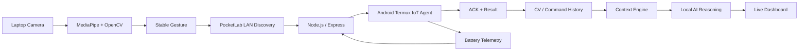

<div align="center">

# ⚡ A54 PocketLab

### AI-Powered Android Device Laboratory

**Computer Vision · IoT · Edge Intelligence · Context Engine · Live Dashboard**

<p>
  
  
  
  
  
  
</p>


> A real local edge-computing laboratory built around an Android phone, a laptop computer-vision agent, a persistent Node.js server, an IoT telemetry agent, contextual reasoning, and a live operations dashboard.

</div>

---

## ✨ What is PocketLab?

PocketLab turns an Android phone into a **portable edge device laboratory**.

The finished system combines:

- **Laptop Computer Vision** — MediaPipe + OpenCV detect stable hand gestures.
- **Automatic LAN Discovery** — the laptop discovers the PocketLab server on the local Wi-Fi network.
- **Android IoT Agent** — Termux collects battery telemetry and executes approved commands.
- **Command + ACK pipeline** — commands are queued, executed, acknowledged, and recorded.
- **CV History** — gesture events are linked to commands and their results.
- **Context Engine** — device state, telemetry, activity, and safety state are consolidated into a context model.
- **Local AI reasoning** — the current context is converted into a structured risk/interpretation response.
- **Live Dashboard** — the whole system is observable from a browser.

---

## 🧠 Why this project is different

This is not just a gesture-recognition demo.

A gesture can travel through the **entire system**:

```text
Laptop Camera
      │
      ▼
MediaPipe / OpenCV
      │
      ▼
Stable Gesture
      │
      ▼
PocketLab LAN Discovery
      │
      ▼
Node.js / Express Server
      │
      ▼
Android Termux IoT Agent
      │
      ├── command execution
      │
      └── acknowledgement + result
                 │
                 ▼
            CV History
                 │
                 ▼
            Context Engine
                 │
                 ▼
           Local AI Reasoning
                 │
                 ▼
            Live Dashboard
```

---

## 🏗️ Architecture



---

## 🖐️ Gesture Control

| Gesture | Command | Purpose | Verified |
|---|---|---|:---:|
| 👍 **Thumb_Up** | `status` | Check device status | ✅ |
| ✌️ **Victory** | `device_info` | Read device identity | ✅ |
| ✊ **Closed_Fist** | `safe` | Enter software safe state | ✅ |

### End-to-end verification

```text
👍 Thumb_Up
    → status
    → phone ACK
    → online result
    → CV history
    → dashboard update

✌️ Victory
    → device_info
    → phone ACK
    → device information
    → CV history
    → dashboard update

✊ Closed_Fist
    → safe
    → phone ACK
    → software safe state
    → CV history
    → context state update
```

---

## 📡 Automatic LAN Discovery

The laptop does not require the phone's IP to be hard-coded into the CV agent.

PocketLab advertises itself on the local network and the CV agent discovers the server automatically.

```text
Wi-Fi
  │
  ├── Laptop
  │
  └── Android / PocketLab
          │
          └── UDP discovery
                  │
                  ▼
               HTTP API
```

---

## 📱 Android / Termux IoT Agent

The Android side runs inside Termux and provides:

### Telemetry

- Battery percentage
- Battery temperature
- Charging state
- Battery health
- Device identity
- Network information

### Command polling

The agent periodically checks for queued commands, executes supported commands, and posts an acknowledgement/result back to the PocketLab server.

The agent is designed to stay alive through persistent Termux jobs.

---

## 🧩 Context Engine

PocketLab consolidates information from multiple subsystems into one contextual state:

```text
Device state
Telemetry
Latest CV action
Command result
Recent activity
Safety state
Context rules
```

That gives the reasoning layer a structured view of what is happening instead of treating each API call as an isolated event.

---

## 🤖 Local AI Reasoning

The local reasoning layer consumes the context model and produces a structured interpretation containing:

- risk level
- explanation
- recommended action
- next action
- context signals

This lets PocketLab move from:

> “A gesture happened.”

to:

> “What does the current system state mean, and what should happen next?”

---

## 📊 Live Dashboard

The dashboard is served directly from the PocketLab server.

### Main views

```text
Overview
Device
Network
Security Lab
IoT
Command Center
Logs
AI / CV
Settings
```

The dashboard reads the live backend rather than relying on mock values.

### Browser vs. real CV pipeline

The browser camera preview is optional.

The real gesture pipeline is:

```text
Laptop webcam
   ↓
hand_tracking.py
   ↓
MediaPipe / OpenCV
   ↓
PocketLab
```

---

## 🔌 API Surface

| Endpoint | Role |
|---|---|
| `GET /api/device/command` | Read current command state |
| `POST /api/device/command` | Queue a device command |
| `POST /api/device/command/ack` | Acknowledge command execution |
| `POST /api/telemetry` | Receive Android telemetry |
| `GET /api/telemetry/iot` | Read latest phone telemetry |
| `POST /api/cv/event` | Record CV event |
| `GET /api/cv/history` | Read persistent CV history |
| `GET /api/context` | Read consolidated context |
| `GET /api/context/rules` | Read contextual rule evaluation |
| `GET /api/ai/interpret` | Read local AI interpretation |

---

## 🚀 Running the project

### Laptop CV agent

```powershell
cd C:\PocketLab-AI
.\.venv\Scripts\Activate.ps1
python hand_tracking.py
```

The CV agent opens the webcam, discovers the PocketLab server, recognizes stable gestures, and sends commands.

### Android server

```bash
cd ~/pocketlab/server
~/pocketlab/server/start-server.sh
```

### Android telemetry agent

```bash
cd ~/pocketlab/iot
~/pocketlab/iot/start-agent.sh
```

### Dashboard

```text
http://<phone-ip>:3000/dashboard/
```

When served directly by PocketLab, the dashboard prefers the current server origin.

---

## 🛡️ Persistence

PocketLab uses persistent Termux jobs for the core Android services:

```text
start-server.sh
start-agent.sh
```

This allows the server and telemetry agent to continue operating after the SSH session ends.

---

<details>
<summary><strong>🔍 Testing checklist</strong></summary>

```text
✅ Automatic LAN discovery
✅ Server connectivity
✅ Android telemetry
✅ Telemetry persistence
✅ Command queue
✅ Command acknowledgement
✅ Gesture → command mapping
✅ CV history linkage
✅ Context state
✅ Safety state
✅ AI interpretation
✅ Dashboard live data
✅ Dashboard command history
✅ Server persistence after SSH disconnect
✅ IoT agent persistence
```

</details>

<details>
<summary><strong>📂 Project Structure</strong></summary>

```text
A54-PocketLab/
│
├── hand_tracking.py
├── gesture_recognizer.task
├── .gitignore
│
├── dashboard/
│   ├── index.html
│   ├── app.js
│   └── style.css
│
├── iot/
│   ├── telemetry-agent.sh
│   └── start-agent.sh
│
├── server/
│   ├── server.js
│   ├── package.json
│   ├── package-lock.json
│   └── start-server.sh
│
└── docs/
    └── pocketlab-hero.gif
```

</details>

<details>
<summary><strong>⚙️ Environment notes</strong></summary>

### Laptop

- Windows
- Python virtual environment
- OpenCV
- MediaPipe
- Gesture recognition task model

### Android

- Android
- Termux
- Node.js
- Express
- Bash agent scripts
- Termux job scheduler

### Network

The laptop and phone should be reachable on the same local Wi-Fi network for automatic discovery and local API communication.

</details>

<details>
<summary><strong>🔮 Future expansion</strong></summary>

The architecture is ready for additional physical edge hardware.

Planned expansion:

- ESP32 / physical sensor node
- external environmental sensors
- actuator control
- richer automation rules
- more CV gestures
- multi-device discovery
- stronger authentication
- TLS for non-local deployments

</details>

---

## 💙 Built as a real systems project

PocketLab grew from an Android-based Linux/IoT laboratory into a complete local edge-computing stack combining **computer vision, networking, telemetry, device control, context, AI reasoning, and observability**.

The current release keeps the system local-first and hardware-light: the Android phone acts as the edge device while the laptop provides CV intelligence.

<div align="center">

### ⚡ PocketLab

**Discover → See → Decide → Act → Observe**

</div>
