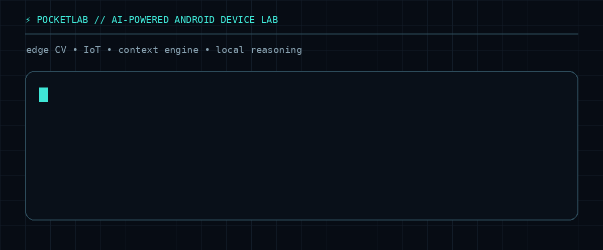
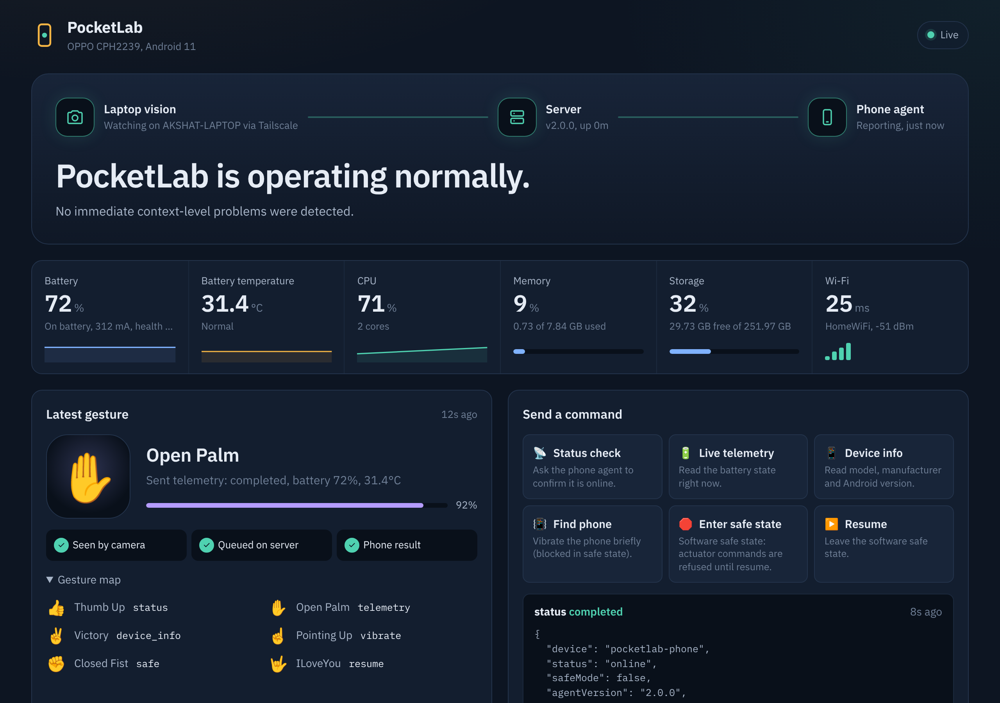
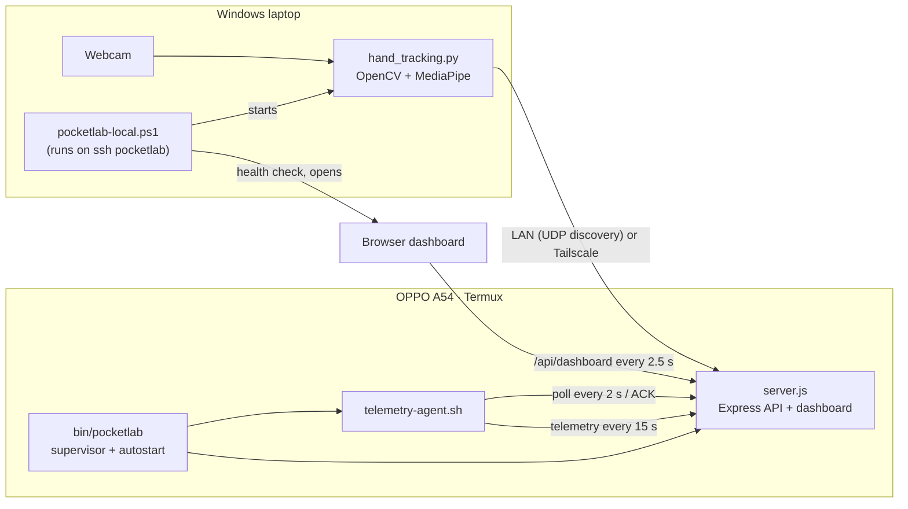

<div align="center">

# ⚡ A54 PocketLab

### An Android phone as an edge server, controlled by hand gestures

**Computer Vision · IoT · Edge Computing · Context Engine · Live Dashboard · Tailscale**

<p>
  
  
  
  
  
  
</p>



</div>

PocketLab turns an **OPPO A54 (Android 11, Termux)** into a small edge server. The phone runs a Node.js API, a telemetry/command agent and the dashboard. A **laptop webcam** recognises hand gestures with MediaPipe and turns them into commands that the phone executes and acknowledges. Everything is reachable on the same Wi-Fi or from anywhere through **Tailscale**.

---

## 🚀 Daily use

```text
Phone  (Termux):   sshd            ← or just open Termux; it starts everything
Laptop (any shell): ssh pocketlab
```

That's it. Logging in over SSH starts the server and IoT agent on the phone (if they aren't already running), and on the laptop it opens the dashboard and starts the gesture agent. You'll see this in the SSH window:

```text
⚡ PocketLab online
   Tailscale: http://100.82.17.93:3000/dashboard/
   Wi-Fi:     http://192.168.1.42:3000/dashboard/
```

Closing SSH, the browser or PowerShell does **not** stop anything. If Android kills a process, a supervisor restarts it within seconds and a 15-minute watchdog job brings back anything else.

---

## 📊 Dashboard



<sub>Screenshot from a local test run of v2.0 (phone sensors stubbed in the test environment).</sub>

The dashboard is served by the phone at `http://<phone>:3000/dashboard/` and shows:

- **Signal path** — laptop vision → server → phone agent, each lit from real heartbeats, with the reasoner's headline underneath.
- **Live readings** — battery (with trend), battery temperature, CPU, memory, storage, Wi-Fi signal and latency.
- **Latest gesture** — what the camera saw, confidence, and whether the command reached the phone and came back.
- **Commands** — one-click commands with the phone's real JSON result.
- **Activity** — gestures and commands in one timeline, filterable by problems.
- **Reasoner** — alerts, recommendations and observations from the deterministic rules engine.
- **Phone & network** — model, Android version, uptimes, Wi-Fi and Tailscale addresses, on-demand speed test.

If the server goes away, the page keeps the last data dimmed, says exactly what failed and how to check it, retries with backoff, and recovers by itself.

---

## 🛠️ One-time setup

### 1. Phone (Termux)

Install **Termux** and **Termux:API** from the same source (F-Droid or GitHub), then in Termux:

```bash
curl -fsSL https://raw.githubusercontent.com/akshatparashar/A54-PocketLab/main/scripts/termux/install.sh | bash
```

This installs `nodejs git openssh termux-api curl procps`, puts the repo at `~/pocketlab` (an older non-git `~/pocketlab` is moved to `~/pocketlab.backup-<date>` and your `cv-history.json` is kept), installs server dependencies, adds the `pocketlab` command and enables autostart.

Recommended on the phone: **Settings → Battery → Termux → allow background activity / don't optimise**, and optionally install **Termux:Boot** so PocketLab starts after a reboot.

### 2. Laptop (Windows)

```powershell
cd C:\PocketLab-AI
git pull
.\scripts\windows\Install-PocketLab.ps1                       # uses the existing "Host pocketlab" address
# or: .\scripts\windows\Install-PocketLab.ps1 -PhoneHost oppo-a54.tail4b1d6d.ts.net
```

The installer:

- creates `.venv` and installs `requirements.txt` (OpenCV, MediaPipe, requests);
- backs up `~/.ssh/config`, then writes a managed `Host pocketlab` block with `LocalCommand` (this is what makes `ssh pocketlab` start the laptop side) and a `Host pocketlab-cmd` alias for scripts;
- adds a small `ssh pocketlab` hook and a `pocketlab` command to your PowerShell profile as a second trigger (skip with `-NoProfileHook`);
- checks that the phone answers on ports 8022 and 3000.

If the phone's Tailscale address ever changes, rerun it with `-PhoneHost <new address>`. That address is the **only** place the phone is configured: SSH, the launcher and the gesture agent all read it from `~/.ssh/config`.

---

## 🏗️ Architecture



### A gesture's trip

```text
👍 Thumb_Up seen for 5 stable frames
  → POST /api/cv/event                 (gesture recorded)
  → POST /api/device/command  status   (queued)
  → phone agent picks it up (≤ 2 s), runs it, POST /api/device/command/ack
  → server links the result to the gesture in cv-history.json
  → dashboard: "Seen by camera ✓  Queued on server ✓  Phone result ✓"
```

The camera never freezes while this happens: actions run on a background thread.

---

## 🖐️ Gestures and commands

| Gesture | Command | What the phone does |
|---|---|---|
| 👍 Thumb_Up | `status` | Confirms the agent is online (also reports safe state and uptime) |
| ✋ Open_Palm | `telemetry` | Reads the battery right now |
| ✌️ Victory | `device_info` | Reads model, manufacturer, Android version, kernel |
| ☝️ Pointing_Up | `vibrate` | Vibrates for 0.5 s to find the phone — refused in safe state |
| ✊ Closed_Fist | `safe` | Enters the software safe state |
| 🤟 ILoveYou | `resume` | Leaves the software safe state |

**Safe state** is a software state kept by the agent (`~/pocketlab/run/safe-mode`, survives restarts). While it's on, actuator commands such as `vibrate` are refused and reported as *blocked* (not as failures). It is not a hardware emergency stop.

The server only accepts these commands; anything else gets a `400` listing the supported ones.

---

## 🌐 How the gesture agent finds the phone

`hand_tracking.py` tries, in order, and uses the first that answers `/api/health`:

1. `--api URL` or `POCKETLAB_API_BASE` (the launcher passes the SSH address here)
2. `apiBase` in `pocketlab.config.json` (optional, see `pocketlab.config.example.json`)
3. **UDP LAN discovery** — broadcast `POCKETLAB_DISCOVER` on port `37020` (unchanged protocol)
4. the `HostName` of `Host pocketlab` in `~/.ssh/config` (your Tailscale address)
5. `fallbackHosts` in `pocketlab.config.json`

If the connection drops it re-resolves automatically with backoff, and the camera window shows which route it's using (LAN or Tailscale).

---

## 📱 The `pocketlab` command (phone)

```text
pocketlab status            what's running + dashboard URLs
pocketlab up                start anything that isn't running (never duplicates)
pocketlab restart           restart server and agent
pocketlab down              stop server and agent (sshd stays up)
pocketlab logs server -f    follow the server log (also: logs agent)
pocketlab doctor            check packages, Termux:API, autostart
pocketlab update            git pull + npm install + restart
pocketlab autostart enable|disable|status
```

### How autostart works

| Trigger | What starts it |
|---|---|
| Opening Termux / `ssh pocketlab` | `~/.pocketlab-autostart.sh`, sourced from `~/.bashrc` and the login profile (interactive shells only) |
| A process crashes | a supervisor loop restarts it (backoff 3 s → 60 s) |
| Android kills everything | `termux-job-scheduler` job **#4271** every 15 min (`bin/pocketlab-job`) |
| Phone reboot | `~/.termux/boot/pocketlab` if Termux:Boot is installed |
| Laptop side | `LocalCommand` in `~/.ssh/config` → `scripts/windows/pocketlab-local.ps1` (hidden, single instance, opens the dashboard at most every 10 min) |

The old `server/start-server.sh`, `iot/start-agent.sh` and `ssh/start-sshd.sh` still exist and now call `pocketlab up`, so previously registered jobs keep working without creating duplicates.

On the laptop, `.\Start-PocketLab.ps1` (or `pocketlab` in PowerShell) does the same as `ssh pocketlab` but shows each step, without opening a shell.

---

## 🔌 API

All existing routes and field names are unchanged. New in v2 are marked ★.

| Endpoint | Purpose |
|---|---|
| ★ `GET /api/health` | Fast liveness check (`service`, `version`, `uptimeSeconds`) |
| ★ `GET /api/dashboard` | Everything the dashboard needs, in one fast call |
| `GET /api/telemetry` | Phone snapshot (cached probes; add `?speedtest=1` to run a speed test) |
| ★ `POST /api/network/speedtest` | Run the ~10 MB speed test on demand |
| `POST /api/telemetry` | Agent telemetry (raw `termux-battery-status` JSON is normalised) |
| `GET /api/telemetry/iot` | Latest agent telemetry |
| ★ `GET /api/telemetry/history` | Last hour of battery/temperature/memory samples |
| ★ `GET /api/device/commands` | Supported commands with descriptions and gestures |
| `GET /api/device/command` | Oldest queued command, else the latest (`?format=text` for the agent) |
| `POST /api/device/command` | Queue a command (`{ "command": "status", "source": "…" }`) |
| ★ `GET /api/device/command/:id` | One command's status and result |
| ★ `GET /api/device/command/history` | Last 50 commands (persisted) |
| `POST /api/device/command/ack` | Agent acknowledgement with the real result |
| `POST /api/cv/event`, `GET /api/cv/event` | Record / read the latest gesture |
| ★ `POST /api/cv/heartbeat` | Gesture agent liveness (host, fps, route) |
| `GET /api/cv/history`, `PATCH /api/cv/history/:id`, `DELETE /api/cv/history` | Persistent gesture history |
| `GET /api/context`, `GET /api/context/rules` | Context model and rule evaluation |
| `GET /api/ai/interpret` | Local reasoner output |

UDP discovery: port `37020`, message `POCKETLAB_DISCOVER`. HTTP: port `3000`.

### About the "AI"

`/api/ai/interpret` is a **deterministic rules engine** running on the phone. It produces a risk level, headline, observations, alerts, recommendations and a next action from real context — no LLM is called. Its response still includes `llmReadyContext` so a generative model can be added later as an optional layer.

---

## 🩺 What was fixed in v2

| Problem | Cause | Fix |
|---|---|---|
| Dashboard showed no data / flipped to "Server offline" | `GET /api/telemetry` ran a 5 MB down + 5 MB up speed test and 4 pings on **every** request (10–20 s, ~10 MB of data each time) while the dashboard polled it every 5 s | Probes are cached and refreshed in the background; speed test only on demand. Endpoints now answer in milliseconds |
| Telemetry endpoint could return 500 on Android 11 | `os.networkInterfaces()` is blocked for apps (netlink) | Falls back to `ifconfig` and `termux-wifi-connectioninfo` |
| `ERR_CONNECTION_REFUSED` until a manual restart | No crash guard or auto-restart; old Termux jobs could replace each other | Crash guards, supervisor with backoff, one watchdog job with a fixed ID, login-hook autostart |
| Command Center commands always failed | It offered `network`, `battery`, `ping`, `restart-agent`, which the agent never implemented | Dashboard reads the supported list from the server; server rejects unknown commands |
| Fake values in the dashboard | Hard-coded 75 %, −312 mA, SSH port 22, "2 ports open" | Removed; every value comes from the phone or shows "—" with a reason |
| Two quick gestures → one lost | Single-slot command queue | Real FIFO queue with per-command lookup and history |
| Agent restart re-ran the last command | The agent ignored the command status | Only `queued` commands run; unacknowledged ones expire after 45 s |
| Camera froze for up to 8 s per gesture | Command wait ran on the video loop | Background worker thread |
| No Tailscale support in the gesture agent | LAN broadcast only | Configurable endpoint + SSH-config host, LAN discovery kept |
| Agent hung if Termux:API was missing | `termux-battery-status` can block forever | Timeouts on every Termux:API call |
| Logs grew forever | Every telemetry packet logged | Event-only logging + rotation at 4 MB |

---

## 🧯 Troubleshooting

| Symptom | Check |
|---|---|
| Dashboard says it can't reach the server | On the phone: `pocketlab status`, then `pocketlab logs server` |
| Battery shows "Termux:API not answering" | Install the **Termux:API app** (same store as Termux) and `pkg install termux-api`; run `pocketlab doctor` |
| `ssh pocketlab` connects but nothing opens on the laptop | See `%LOCALAPPDATA%\PocketLab\launcher.log`; run `.\Start-PocketLab.ps1` to watch each step |
| `ssh: connect … refused` | Type `sshd` in Termux; check Tailscale is connected on both devices |
| Phone's Tailscale IP changed | `.\scripts\windows\Install-PocketLab.ps1 -PhoneHost <new address or MagicDNS name>` |
| Services stop when the screen is off | Allow Termux background activity in battery settings; keep the Termux notification |
| Don't want the browser/camera to open on every SSH | Set `POCKETLAB_AUTOSTART_BROWSER=0` or `POCKETLAB_AUTOSTART_CV=0` in Windows environment variables |

---

<details>
<summary><strong>📂 Project structure</strong></summary>

```text
A54-PocketLab/
├── hand_tracking.py              laptop gesture agent
├── gesture_recognizer.task       MediaPipe model
├── requirements.txt
├── Start-PocketLab.ps1           laptop: one command with visible steps
├── pocketlab.config.example.json
├── bin/
│   ├── pocketlab                 phone: up/down/status/logs/doctor/update/autostart
│   └── pocketlab-job             phone: 15-minute watchdog job
├── server/
│   ├── server.js                 API, dashboard host, context engine, discovery
│   ├── package.json / package-lock.json
│   └── start-server.sh           legacy entry → pocketlab up
├── iot/
│   ├── telemetry-agent.sh        phone telemetry + command agent
│   └── start-agent.sh            legacy entry → pocketlab up
├── ssh/start-sshd.sh             legacy entry → pocketlab up
├── dashboard/                    index.html, style.css, app.js
├── scripts/
│   ├── termux/install.sh         phone one-time setup
│   └── windows/
│       ├── Install-PocketLab.ps1 laptop one-time setup
│       └── pocketlab-local.ps1   laptop autostart (used by ssh pocketlab)
└── docs/
```

Runtime files (`run/`, `logs/`, `server/cv-history.json`, `server/command-history.json`) are git-ignored.

</details>

<details>
<summary><strong>🔍 Verification status</strong></summary>

Tested in a Linux environment with the Termux commands stubbed:

```text
✅ Server, agent and supervisor start; `pocketlab up` is idempotent (no duplicates)
✅ Server killed with -9 → restarted by the supervisor within ~5 s
✅ Telemetry, commands, FIFO queue, ACKs, expiry, safe state blocking vibrate, resume
✅ Server-side linking of command results into gesture history
✅ Gesture agent: LAN discovery, fallback after a dead configured address, all six gestures
✅ Dashboard: desktop + mobile layouts, no console errors, offline banner and auto-recovery
✅ Login hook starts everything on an interactive SSH/Termux login; non-interactive SSH is untouched
✅ PowerShell scripts parse; ssh config rewrite is idempotent and keeps other hosts
```

Still to confirm on the real devices: Termux:API readings on the A54, `LocalCommand` on your Windows OpenSSH, and all gestures over Tailscale from a different network.

</details>

---

## 🔮 Next

- ESP32 sensors/actuators reporting to the same command queue
- Optional LLM layer on top of `llmReadyContext`
- Tailscale MagicDNS name as the default phone address

<div align="center">

Built by **Akshat Parashar**

</div>
